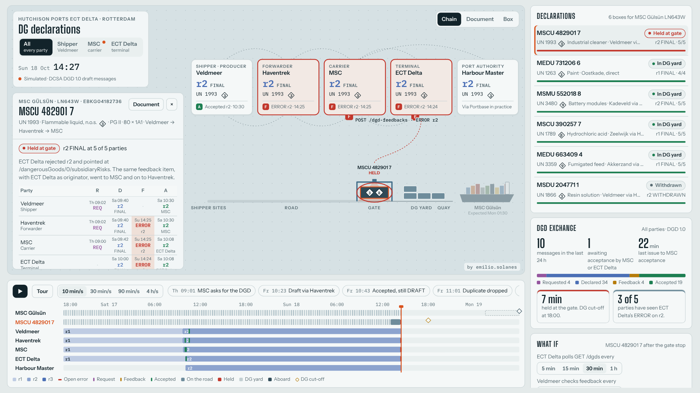

# Dangerous Goods Declaration Simulator: one box, one wrong number

Built by emilio.solanes. Personal project, not affiliated with or endorsed by any company. Simulated data.

An interactive simulation of six export containers for MSC Gülsün at Hutchison Ports ECT Delta, Rotterdam, from Thursday 15 to Tuesday 20 October 2026. Every declaration, request and feedback item is exchanged as a DCSA Dangerous Goods Declaration (DGD) 1.0 message, following the alpha snapshot of 6 November 2026. Same design system as the port call simulator.



Open `index.html` in any current browser. It is a single self-contained file with no third-party code and runs offline; only Google Fonts load from outside, and without internet the page falls back to system fonts. To share a link instead, enable GitHub Pages (Settings, Pages, Deploy from branch, `main`, root).

## Story

MSCU 482901 7 is declared as UN 1993, class 3. At the ECT Delta gate on Sunday 14:20 the placards show class 3 and class 8. ECT Delta rejects revision 2 with a feedback item pointing at `/dangerousGoods/0/subsidiaryRisks`, the same item is relayed to MSC and Haventrek, and Veldmeer issues revision 3 as UN 2924 (3, 8). A new UN number is a reclassification, so MSC's DG desk re-checks stowage and segregation before re-approving. With the default settings the box is released at 16:29, 1 h 31 min before the DG cut-off, and loads on Tuesday 05:10.

This is a scenario walkthrough with a small what-if model. Shipper issue times and the gate stop are inputs; relays, reviews, polls, duplicates, the release time and whether the box makes the cut-off are computed from rules (listed in About and at the top of the model in `src/app.js`). The What if panel changes ECT Delta's polling interval, the shipper's feedback polling interval, the correction time and MSC's re-approval time.

The page opens paused on an 11 step tour, "Follow MSCU 482901 7". Open with `#explore` to skip it.

Five background boxes show the other parts of the standard: a direct shipper push (paint), a DGD request and a pending review on a referenced document (lithium batteries), an unchanged forward (hydrochloric acid), equipment-level fumigation, and a withdrawn declaration (resin).

## Layout

- **Stage views:** Chain (parties, messages, push and pull, the physical lane), Document (one party's copy, field diff, feedback pointer), Box (container cutaway, placards against the declaration).
- **Party views:** All, Shipper, MSC, ECT Delta. A party view shows only what that party has sent or received by the clock time: other parties' desks are masked, and the card, revision list, document diff, declarations list, stats, timeline, alerts and stream are filtered. The physical lane is the world as it is.
- **Card:** the selected box, with one row per party and columns R, D, F, A (request, declaration held, feedback, accepted).
- **Timeline:** a rolling 60 h window, one row per party showing the revision held, plus the box and the vessel.
- **Panels:** Declarations, DGD exchange, What if, Parties, Alerts, Message stream, About.

Colours: Requested purple, Declared blue, Feedback amber, Accepted green. Red marks an ERROR, a rejection or a held box. Orange marks now, selected or fresh.

## Files

- `index.html`: built page, ready to open or publish.
- `src/template.html`: page markup and About text.
- `src/base.css`: port call simulator design system, unchanged.
- `src/dgd.css`: DGD additions.
- `src/app.js`: model (parties, boxes, revisions, messages, alerts, moments) and UI.
- `tools/build.py`: inlines the CSS and JS into `index.html`. Run after editing `src/`.
- `tools/shot.py`: Playwright screenshots into `shots/`.
- `tools/sweep.py`: renders every box, view and party view across the timeline for five what-if settings, and checks message consistency and that no party view shows a revision that party does not hold.
- `tools/validate.py`: validates every payload against the DGD OpenAPI (strict, no undeclared properties) and the DGD 1.0 conformance content checks. Needs the OpenAPI YAML from the DCSA package, which is not included here.
- `docs/preview.png`: the screenshot above.

```
python tools/build.py
python tools/sweep.py
python tools/validate.py path/to/dcsa-dgd-openapi-specification.yaml
python tools/shot.py '[{"name":"gate","js":"__dgd.setPlaying(false);__dgd.setTime(__dgd.T(3,14,24));__dgd.refresh()"}]'
```

The Playwright scripts need `pip install playwright pyyaml jsonschema` and `playwright install chromium`.

## Hooks for recording

`window.__dgd`, also exposed as `window.__portcall`:

- `state`, `setTime(t)`, `setPlaying(bool)`, `setView('chain'|'doc'|'box')`, `select(boxId)`, `setLens('ALL'|'SHP'|'MSC'|'ECT')`, `refresh()`, `renderNow()`
- `guide(i)`, `hideGuide()`, `setParams({ ectPoll, shpPoll, fix, reapprove })` in minutes
- `T(day, hour, minute)`: simulation minutes, day 0 is Thursday 15 October
- `screen(kind, id)`: screen position of a `desk` (party id), `box` (box id), `field` (JSON Pointer in the Document view) or `panel` (element id)
- `data`: boxes, messages, moments, tour steps, key times (`EV`), `payload(message)`

Box ids: `H` hero MSCU 482901 7, `P` paint, `L` lithium batteries, `C` hydrochloric acid, `G` fumigated, `W` withdrawn resin. A hash of `#dark` or `#light` forces the theme.

## Decisions taken

- Payloads carry the fields the story uses plus those the conformance content checks ask for (parties, seals, certificates, emergency contact). 816 payloads across 10 what-if settings pass `tools/validate.py` against the alpha OpenAPI.
- ECT Delta's `GET /dgds` window starts 10 min before its previous poll, so duplicates arise from the overlap and are dropped by reference and revision.
- Bodies follow the generated OpenAPI wrappers (`DGDeclarations`, `DGDFeedbacks`, `DGDRequests`). The package's worked-example files use bare arrays.
- DGD has no sending-party headers, so sender and receiver come from `submissionOriginator`, `forwardingEvents` and the feedback `originatingParty`.
- The Harbour Master receives a direct push, as in a port without a community system; the desk, the payload note and About say that in Rotterdam this goes through Portbase Notification Dangerous Goods.
- The gate releases the box only after both ECT Delta has accepted r3 and MSC has re-approved the reclassified booking. MSC's re-approval reaches the gate outside DGD and is not drawn as a message.
- Not modelled: misdeclaration fees, a refusal by the terminal.
- Shipper and forwarder names, references, booking numbers and the voyage are fictional. Container numbers have valid check digits and are made up.

## Open checks

- EmS codes, UN and class pairings and the IMDG edition (42-24) are from general knowledge, not the package. Have a DG specialist review them.
- Assumed: DG cut-off Sunday 18:00, the rule timings, the gate placard check, a weekly service.
- Moment chips and the What if trace are global navigation and name later events even in a party view.

## License

Code: MIT, see `LICENSE`.

## Series

Part four, after the [Port Call Simulator](https://github.com/emiliosolanes/port-call-simulator) (one ship across two ports, and one terminal over 48 hours) and the [Track and Trace Simulator](https://github.com/emiliosolanes/tnt-simulator) (one container, five buckets of events).

## License

MIT, see `LICENSE`. Simulated data. Personal project, not affiliated with the companies shown.
